# PAPER_LOGIC — per-EM W₁ paper argument map

**Date**: 2026-10-14 01:10（D-20261014-1 本文の削減を適用後: 11,097 → 9,617 語、74 cuts + 復元、拒否権項目 15。旧版 2026-09-06 は v6 以前の構成（§2.5 operability・§4.5・判定の仕組み）を参照していたため全面刷新）
**Manuscript**: `paper/per_em_W1_wiley.tex`（21 pp、本文 9,617 語、abstract 250 語、表 9・図 4、`\numval{}` 由来の数値のみ、unsourced 0）
**Question / Aim**（`LAB_STATUS.md` A1）: 効果修飾因子（EM）の分布の類似性を定量的に評価する指標を提示すること。判定規則・partner 数・手続きは規定しない（`memory/feedback_quantify_not_decide.md`）
**一文で**: ICH E17 が「EM 分布の類似性」で記述する地域併合の判断に、EM ごとの Wasserstein-1 距離（元の単位）を物差しとして与える。W₁ を採用する理由は三つ: (i) 位置以外の分布差に応答する、(ii) 命題 1 の上界 Δ_max = L_clinical·W₁ の定数が per-unit の臨床勾配である、(iii) その上界は class の全 CATE で valid、勾配だけが制約なら sharp（KR 双対）、CATE が単調なら L(W₁+|Δμ|)/2 まで締まり、特定の CATE には保守的である。推定は percentile bootstrap 区間。

## 節番号の正（compiled, 2026-10-12）

§1 Introduction / §2.1 existing / §2.2 W₁ + Prop. 1 / §2.3 estimation + null floor / §2.4 calibration / §3.1 Study 1 identification（3.1.1 design, 3.1.2 blind–recovering, 3.1.3 required n）/ §3.2 Study 2 estimation / §4.1 scenario / §4.2 null floor / §4.3 distances + ranks / §4.4 clinical interpretation / §5 Discussion / A.1 proofs / A.2 asymptotics / B R code。
Tables: 1 required n（13 cell × W₁/KS/SMD、MC 区間）/ 2 scenarios / 3 estimation（bias・coverage・RMSE・width を 1 表に統合、10-14）/ 4 区間比較（percentile・片側上限・basic）/ 5 Study 2 拡張（11 cell）/ 6 R8 baseline / 7 null floor / 8 W₁ + rank（† 行に rank interval）/ 9 L*。Appendix A.1（Jensen の導出、10-14 移動）、A.3（KS bound との比較・attainment の台と Lee の算術）。Figures: 1 W₁ 定義 / 2 selection AUC / 3 bias・coverage・width / 4 GUSTO forest（†）。

## 論理構造（上から下が論証の依存）

```mermaid
flowchart TD
  subgraph S1["§1 Introduction — gap"]
    A1["ICH E17: pooling を EM 分布の類似性で記述、measure なし"]
    A2["既存実務: 地域ごとの代表値（Komiyama Ch.4 の一例）/ SMD は位置のみ<br/>PREVENT: EM 分布の類似で事後併合<br/>先行: 同じ不等式は OT domain adaptation（Shen 2018）、generalizability index（Tipton）、trimmed Mallows の同等性検定（Munk & Czado）"]
    A3["Gap 1: 分布そのものの距離が提案・評価されていない<br/>Gap 2: 'clinically meaningful' を操作化する物差しが無い"]
    A1 --> A3
    A2 --> A3
  end
  subgraph S2["§2 Methods"]
    B1["§2.1 三つの要請: (i) 位置以外 (ii) 臨床尺度 (iii) 臨床勾配を定数とする到達可能な上界"]
    B2["§2.2 per-EM W₁（元の単位）= CDF 間の面積<br/>Prop. 1: |τ̄₁−τ̄₂| ≤ L·W₁（可縮な効果尺度）、勾配だけが制約なら sharp（KR）<br/>単調 CATE: sharp bound = L(W₁+|Δμ|)/2；bounded effect でさらに締まる → 保守的上界<br/>違いは定数（per-unit 臨床勾配）。KS 比較は A.3"]
    B3["§2.3 plug-in 和 + percentile bootstrap (B=2,000)<br/>E Ŵ₁ ≥ W₁（Jensen、全 n）；enrolled sample では bound が F̂ で厳密<br/>一致性: Fang–Santos の条件、境界では不一致<br/>null floor = 片側 5% 検定（permutation と 30/30 一致）、多重性調整なし"]
    B4["§2.4 較正二経路: L 既知 → Δ_max 区間 / L 未知 → L* = Δ_clin/W₁ vs L_UB<br/>estimation-centered、cutoff なし"]
    B1 --> B2 --> B3 --> B4
  end
  subgraph S3["§3 Simulation"]
    C1["Study 1 識別（selection task、k は oracle）— 全部異なる partner の順序付けや効果差による順位は評価しない<br/>線形 CATE ならスケール差は効果差 0、V 字 τ=L|x−50| なら S5 で L·W₁ を attain し SMD は 0<br/>SMD blind 7/13；W₁・KS は全 cell で到達；W₁ が少ない 11（3 は構成上）/ 重なる 1 / KS が少ない 1<br/>control の反転は登録済み check で説明: Set 4 母集団は Ŵ₁ の null SD を 1.62 倍、KS は 1.00、ΔAUC の符号反転"]
    C2["Study 2 推定（7 scenarios × n=50/100/200、10,000 reps）<br/>S1: 正の bias は n^{-1/2}、coverage 0；非 null は速く減る<br/>約 0.4–1.2 SD, n ≥ 100: coverage 0.92–0.95、10 cell 中 5 が 2 MCSE 下 — S5/S7 は上側に外れ、S6/S4-100 は小さく両側<br/>片側上限の coverage 0.971–0.9999（S5/S7 で名目超、S3/S6 で付近、S4-100 で未満）；basic 区間は n ≥ 100 で劣り境界（S1、S2-50）で勝つ<br/>拡張（登録済み、Table 6）: 非 null 10 cell で coverage 0.921–0.952；応用の operating point（0.2 SD、n=1,000 / 2,900 vs 1,200 丸め）で 0.951 / 0.947、片側上限 0.983 / 0.978"]
  end
  subgraph S4["§4 Application — GUSTO-I（仮想 MRCT）"]
    D1["R8 (n=2,916) vs 15 partners (1,231–4,352)、EM: age・SBP<br/>外れ値（SBP=0、age>100）除外で W₁ 変化 ≤ 0.02 yr / 0.07 mmHg、判定不変；SBP の末尾 0 は 19.9–79.5%<br/>Study 1 の required n は GUSTO に移さない"]
    D2["null floor: age 6/15 unresolved、SBP 1/15"]
    D3["W₁ 順位 + rank interval（患者 bootstrap）<br/>R2/R9 の逆転；mid-table は解像しない"]
    D4["L* 区間 vs L_UB（0.01/yr、0.002/mmHg）— 位置関係のみ、判定なし<br/>単調 CATE を仮定すれば Δ_max は 0.66–1.00（age）/ 0.72–1.00（SBP）倍に"]
    D1 --> D2 --> D3 --> D4
  end
  subgraph S5["§5 Discussion"]
    E1["要請 (i)(ii)(iii) への回答 + 推定の特性づけ<br/>含意: EM ごとに順位は一致しない（Spearman −0.30 [−0.51, 0.02]）／順位 ≠ 臨床的重み"]
    E2["GUSTO では SMD と同順（0.90 [0.70, 0.99]、0.95 [0.90, 0.99]；survey 0.839–0.996）；survey では W₁ と KS の順位も 0.879–0.989 で一致<br/>W₁ を使う理由は効率ではない: SMD が盲目な所で盲目でないこと、定数が臨床勾配で class 内 sharp・保守的な較正を持つこと"]
    E3["限界: Lipschitz 前提（定数は臨床判断、閾値 CATE で緩い＝設計）、共通 CATE、可縮な効果尺度、周辺・連続 EM<br/>多変量: 重み付き ℓ₁ の W_d は交互作用下でも bound、Σ L_k W₁^(k) ≤ W_d（周辺和は下界）<br/>境界: m-out-of-n / numerical delta method が正当な方法（未実施）"]
    E1 --> E2 --> E3
  end
  A3 -->|"要請の定式化"| B1
  B2 -->|"識別できない距離は較正できない"| C1
  B4 -->|"較正は推定に依存"| C2
  C1 -->|"方法を特定"| D1
  B3 -->|"null floor"| D2
  C2 -->|"区間の読み方"| D2
  B4 -->|"L* 経路"| D4
  D4 --> E1
  C1 --> E2
```

## 主張 ↔ 証拠（CLAIMS.md の主要行）

| 節 | 主張（短縮） | CLAIMS | 証拠 |
|---|---|---|---|
| §1 | E17 は measure を与えない；Komiyama は一例；代表値は分布差を取り逃す | C-01, C-02, C-03, C-20 | 原典（E17 p.16、Ch.4 §4.6.1、Matsushima p.965–966、Song p.359/362） |
| §2.2 | Prop. 1、τ* で到達、class = 定数 | C-05, C-15, C-16 | 証明（本文）、`lipRangeAge/Sbp` |
| §2.3–2.4 | null floor は片側 5% 検定、L* と区間 | C-06, C-23, C-42 | `results/gusto_operability.csv`、Fang–Santos / Dümbgen |
| §3.1 | SMD blind 7/13；W₁ 11/13（3 は構成上）/1/1；Sets 1–2 の uniform shift は W₁ | C-07, C-08, C-26, C-28, C-40 | `required_n_selection.csv`、`results/derived/required_n_separation.csv`、Table 1 |
| §3.2 | 境界 bias n^{-1/2}；coverage 0.92–0.95、5/10 が 2 MCSE 下；不足は CDF 交差（bias/SD） | C-09, C-17, C-32, C-33 | `w1_raw_summary.csv`、`results/derived/study2_bias_over_sd.csv`、`study2_bias_ratio.csv`、`study1_miss_side.csv` |
| §4 | null floor age 6/15・SBP 1/15；順位と rank interval；R2/R9 逆転；L* vs L_UB | C-10, C-11, C-12, C-35, C-36, C-43 | `gusto_r8_w1_per_pair.csv`、`gusto_rank_intervals.csv`、`gusto_lstar_intervals.csv` |
| §5 | EM ごとに順位が異なる；GUSTO では SMD と同順（区間付き）；survey 0.839–0.996 | C-11, C-37, C-38, C-41 | `gusto_rank_spearman_boot.csv`、`real_data_survey_summary.csv` |
| §5 | Lipschitz 前提の限界、共通 CATE | C-21, C-17 | 本文の論証 |

## 2026-10-12 午後の修正（D-20261012-3: 外部レビュー M1–M8 + 冷読 referee #2 M1–M5）

| 項目 | 判断 | 何をしたか |
|---|---|---|
| REF M1 / EXT M1 attainment | 採用 | 採用理由を三つに（応答性・定数・class 内 sharp）；単調 bound L(W₁+|Δμ|)/2 を eq. (mono_bound) として導出、GUSTO で 0.66–1.00 / 0.72–1.00；KS 比較は A.3 へ；先行研究 6 本を §1 に位置づけ（Shen = 同一不等式、Redko = 同系統、Tipton/Stuart/Dahabreh = 設定の近さ、Munk & Czado = 同等性検定） |
| REF M2 裾の機構 | 採用（protocol 昇格） | `PROTOCOL_set4_control_mechanism.md`、本番 4,000 組、null SD 比 1.62 / 1.00、ΔAUC +0.029 → −0.032；"heavy-tailed" でなく contaminated tails、一般化しない；survey の W₁–KS 一致 0.879–0.989 |
| REF M3 coverage の説明 | 採用 | S5/S7（上側）と S6/S4-100（両側）を分離、Table 4 注の "boundary proximity" を訂正 |
| REF M4 / EXT M3 Study 1 の射程 | 一部採用 | identification・k は oracle・効果差の順位は評価しない；線形 vs V 字の例。Study 3 は断る（θ を固定すると勝者が θ の選択で決まる） |
| REF M5 / EXT M8 Study 2 の範囲 | 採用（完了） | `PROTOCOL_study2_extension.md`: 不均衡 n、t₃、整数格子、n=1,000、応用の operating point（0.2 SD、n 1,000 / 2,900 vs 1,200 を 10 mmHg 丸め）|
| EXT M2 可縮性 | 採用 | §2 冒頭と限界に明記 |
| EXT M4 Jensen・区間 | 採用 | E Ŵ₁ ≥ W₁ を命題に；片側上限 coverage 0.971–0.9999、basic 区間 0.870–0.948（改善せず）を Table 5 に；m-out-of-n / numerical delta を限界に |
| EXT M5 同等性検定 | 断る / 一部 | 決定規則は規定しない（size が臨床入力に依存、事象は Table 10 が表示済み）；permutation は 30/30 一致、多重性の一文 |
| EXT M6 多変量 | 採用（文のみ） | W_d の不等式 2 本を限界に、GUSTO での計算は `/idea` |
| EXT M7 応用 | 一部 | (a) L_UB vs 全体効果（6.3% vs 7.2/7.4%）と Lee 1995 の上限 6.5e-3/yr、(b) 断る（τ̂ は t-PA vs SK）、(c) 外れ値・winsorize・heaping を一文 |
| 体裁 | 採用 | Fig 4 caption、IST-1 引用、del Barrio / van Klaveren、IST 19,435、copyyear、R code |
| 長さ | 一部 | Katrina の A 層 18 件（Simulation −419、Discussion −140）。追加分で本文は約 10,470 語 — 次の周で切る |

## 2026-10-12 午前の修正（D-20261012-2）— 何を、なぜ

| # | 箇所 | 問題 | 修正 | 根拠 |
|---|---|---|---|---|
| C1 | §4.3 | "at the GUSTO-I region sizes both suffice" — KS asym severity 1,252 [1,226, 1,278] は R16 の 1,231 を含む；required n は simulated contrast 固有 | 文を削除、「Study 1 の required n は GUSTO に移さない、null floor で読む」に | `required_n_selection.csv`、Mike A3 |
| C2 | §3 冒頭・§3.2・§4.2 | "coverage は標準化距離で決まる" — n=100 で S3 3.66 SD→0.951、S5 3.84→0.917 | 最低 coverage の 3 cell（S5, S7, S6）が bias/sd(Ŵ₁) 最大の 3 cell、と限定して置換（全 cell の順序ではない — review-fix K3）；"boundary を離れれば nominal" を削除、保守性は S2/S5/S7 に限定、S4 も 5 cell の一つと明記 | `w1_raw_summary.csv`、`study2_bias_over_sd.csv` |
| C3 | §3.2 | "same n^{-1/2} rate as elsewhere" — n^{-1/2} は S1 のみ、他は 1/6–1/3 | null は n^{-1/2}、非 null は速い、S4 のみ MC 誤差内（S3 は 3.7 MCSE） | `study2_bias_ratio.csv`、Katrina 四つ目の目 |
| C4 | §3.1.1・§3.1.3 | "uniform shift は CDF supremum 向き" — Set 1/2 location で W₁ が先（33 vs 39、129 vs 157） | 事実だけ（control は Set 4 内の優位を外す cell）；代替機構は未検証なので書かない | Table 1、S21 |
| M1/M2 | abstract・§3.2 末・§5 ¶1・§4.3 | 「5/10 が 2 MCSE 下」「3 は構成上」が落ちていた | 全 site に付与、abstract 250 語維持 | D-20261011-11 判断 1(a) |
| M3 | §2.2 | attainment 単独では KS と区別できない（KS も step CATE で到達） | 「Lipschitz class 内で到達」、KS の到達を明記、違いは class = 定数 | 数学 |
| M4 | A.2 | "0 of 15" は標本 CDF の件数で母集団条件を言えない | 件数削除、「標本から検証不能、R2 (SBP) は上限で読む」 | 昨夜 Minor 7 を反転 |
| M5 | §5 | Spearman −0.30 は unresolved を含む点順序 | 開示；W₁ vs SMD の Spearman に患者 bootstrap 区間 | `gusto_rank_spearman_boot.csv` |
| M6 | §5・Data availability | IST-1/IST-3 無引用、survey の 1.00 は 0.996 の丸め | \cite 追加、3 桁、DataShare DOI | bib、`CASE_STUDY_CANDIDATES_20261012.md` |
| M7 | §5 | "Lasso が EM 選択の front-end" — outcome Lasso は prognostic 因子、Komiyama の Lasso は重み | 削除、「interaction の証拠が要る」 | §2.4 と Ch.4 |
| M8/m17 | §5 ¶1 | (i)(ii)(iii) が §2.1 とずれ、95 語の一文 | §2.1 に揃え、coverage は「推定の特性づけ」、文を分割 | P1/P2 |
| M9 | 4 箇所 | "estimation criterion" は未定義で推奨に読まれる | n = 50–200 の記述文に | quantify-not-decide |
| M10 | Table 1→2 | SMD の Sets 1–2 が未報告（選択的報告） | 13 cell × W₁/KS/SMD の 1 表に統合、本文に一文 | `required_n_selection.csv` |
| Rachel | §1 | Matsushima: 原典は「割付不均衡と小標本、EM によらない」 | PREVENT の事後併合として書き直し（"slightly" 保持）、bib 著者名訂正 | Matsushima 2024 p.966 |
| Rachel | §4.1 | FTT の "irrespective of age/BP" に ST 上昇/BBB の条件が無い | 条件を復元 | FTT 1994 p.311 |
| Minor | 各所 | 0.4 SD の切り上げ、x₀ 中点、bootstrap 条件、MCSE、順位の表現、二値語、E17 の "similar enough" | 採用 14 件 | Louis m1–m14 |
| 長さ | §3.1.3・§3.2・§5 | 反復段落・リスト | C-30 段落、summary list、経路の反復、KS 代替文を削除 | P3；9,937 → 9,923 語（訂正で足した分とほぼ相殺） |
| review-fix | §4.1・§5 ¶3 ほか | Harvey の改訂マーカー 2 行が後続本文を飲み込み PDF から 2 文が消えていた；Louis 自身の paste-ready 文 5 本が CSV で言い過ぎ | 本文を復元（pdftotext で確認）；5 本を CSV の範囲に限定；"0.4 SD or more" → "0.4 to 1.2 SD" | `FIX_REVIEW_LOUIS_20261012.md` |

## Louis round 3（10-13 00:55、Critical 3 / Major 15 / Minor 9 — 全件適用）

S6 を S4 と一括りにした誤り、上限 coverage の『undercover する所では保守的』、basic 区間の『全 cell で劣る』、マーカーの飲み込み 2 箇所、"light-tailed"、abstract の normal reference・可縮性・control の限定・in original units、"sharp for the class" の見出し化、lipRange と baseline risk、winsorize の選択的報告、heaping の因果表現、位置づけ段落の "in its own units" / "originate"、CLAIMS C-16/C-49、guard REF-M1 の 2 本の書き換え。memory: `feedback_fix_explanations_checked`（修正に添える説明文は CSV で検算）。

## 2026-10-14 本文の削減（D-20261014-1）

`review_response/LENGTH_CUT_20261014.md`。Phase 1（規則内 67 cuts、−1,279）+ Phase 2（Menu 7 件、−357）。Tables 3–5 → `tab:estimation` 1 表、Jensen の導出と Lee の算術は付録へ、§1 の EM 既知度段落・§4.2 の null source 段落・§4.3 の記述段落・§5 の separable 段落を削除、拡張段落は 2 文に。CLAIMS: C-28 retracted（S17）、他は担い手の移動のみ。ゲート全 PASS（21 pp）。

## 開いている点

- Tak の拒否権: `% Paragraph revised 2026-10-12 (D-20261012-2 …)` の全段落に対して投稿前まで
- C4 の機構（Set 4 の裾が Var(Ŵ₁) を膨らませるか）は `/explore` 候補（`IDEAS_BACKLOG.md`）
- `gusto_operability.csv` の旧列 `tau_clin`/`eligible`（code 公開準備で整理）
- 長さ: 10-14 に 11,097 → 9,617 語（1.6×）。規則（主張の担い手・10-12/13 の訂正文・承認段落の新文言は拒否権）の中ではここが限界 — 残りは reviewer が求めた証拠と主張の担い手。拒否権項目 15（`% Cut 2026-10-14 … needs Tak's veto`）を Tak が見る。Tak が RWE 段落（C-39）や roadmap を落とす判断をすれば −100 語次の削減候補は §3.1.1 Design（約 590 語）
- Paper Requests: Lee 1995（age gradient 6e-3/yr）、Matsushima Data S1（PREVENT の類似性の測り方 — novelty claim の最後の反証経路）
