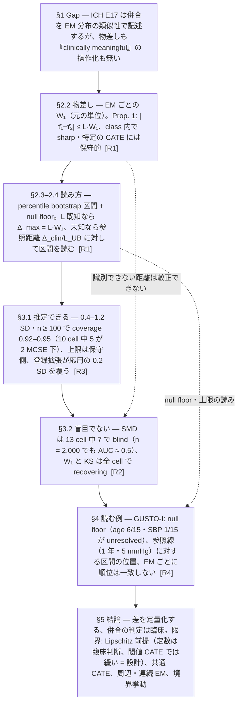

# PAPER_LOGIC — per-EM W₁ paper argument map（二層）

**Date**: 2026-10-16 10:25（D-20261016-1 Step 1–5 + Louis `/review-fix`（Critical 2 / Major 8 / Minor 8、全件採用）を適用した原稿。Tak 07:25「構成図を見ると一目瞭然だが、複雑すぎると思わないか？」→ 原稿側の六つの改善（L* 引退／Study 1 を問い一つに／rank interval 削除／Study 2 の装置 4 → 2／§2.2 の bound を一つに／図の二層化）を順に適用。旧版 2026-10-16 00:45 は 5,796 語・箱 17 の単層図）
**Update 2026-10-17 14:40**（D-20261017-1、Tak「推定の性能を見て、そのあとに実際に使ったときの判定性能を見る方が自然」）: §3 の順を **推定 → 識別** に入れ替えた。§3.1 = Estimation Properties（旧 §3.2）、§3.2 = Identification（旧 §3.1）。節は内容で呼び、'Study 1' / 'Study 2' は本文から消えた（repository の study1/study2 のファイル名は二つの時代の番号が混在するため触らない — `R/README.md`）。compiled 番号: Table 1 scenarios / 2 estimation / 3 extension / 4 required n / 5 GUSTO、Fig 2 bias–coverage / Fig 3 AUC。abstract も推定の文 → selection の文の順に。本文 5,526 語（+9）、15 pp、guards 67/0 FAIL、numbers 105/105、structure 0 placement。commit `a2d55c7`・push 済み（16:05）。下の表と図は新番号に更新済み。
**Manuscript**: `paper/per_em_W1_wiley.tex`（**15 pp、本文 5,526 語**（10-17）: Intro 616 / Methods 1,732 / Simulation 1,376 / Application 829 / Discussion 973、abstract 234 語、**図 4・表 5**（Table 1 は 4 列、Table 5 は Rank 列なし）、付録 A.1–A.2、`\numval{}` 105/105 sourced、guards 67 本 0 FAIL、**未 commit**）
**要約図（artifact）**: https://claude.ai/artifact/1imDe3FMuEXKyW2CC7hehc
**物差し**（`LAB_STATUS.md`）: **A1** 効果修飾因子（EM）の分布の類似性を定量的に評価する指標を提示する → **R1** 定義と性質（§2）／**R2** 盲目でない（§3.2）／**R3** 推定量と区間の性能（§3.1）／**R4** 読み方の例示（§4）。判定規則・partner 数・結合規則は規定しない。

**一文で**: ICH E17 が「EM 分布の類似性」で記述する地域併合の判断に、EM ごとの Wasserstein-1 距離（元の単位）を物差しとして与える。共通の CATE が臨床勾配 L で Lipschitz なら地域効果の差は Δ_max = L·W₁ 以下（class 内で sharp、特定の CATE には保守的）。L が未知なら sponsor の上界 L_UB と余裕 Δ_clin から**参照距離 Δ_clin/L_UB**（sponsor の例示入力で併合の閾値ではない；任意の L_UB′ は Δ_clin/L_UB′ で読める）を置き、W₁ の区間をそれに対して読む。推定は percentile bootstrap 区間、null floor が「差の証拠にならない距離」を印す。論文は差を定量化するだけで、併合の判定は臨床に残す。

## 第一層 — 骨格（箱 6 + 結論、各一行）

読者が持つ概念: W₁、L（または L_UB と Δ_clin → 参照距離）、Δ_max、percentile 区間、null floor の五つ（旧版は L*・片側上限・basic 区間・rank interval・必要 n の比較・単調 bound を含めて十二）。

## 第二層 — 節ごとの中身（数値はここだけ）

| 節 | 何を言うか | 証拠（表・図・CSV） | CLAIMS |
|---|---|---|---|
| §1（614 語） | E17 は measure を与えない；日本・中国は地域一貫性を審査；PREVENT は二値特性で事後併合；Song (NMPA) は曖昧さ、Komiyama Ch.4 は代表値の cluster analysis を一例として紹介し評価せず。Gap 1: 分布そのものの距離が無い（代表値一つでは広がり・形・裾の差が距離 0）。Gap 2: 'clinically meaningful' の物差しが無い。先行: 同じ不等式は OT domain adaptation（Shen, Redko）、PS metrics（Stuart）、generalizability index（Tipton）、trimmed Mallows 同等性検定（Munk & Czado）。**貢献 = 臨床勾配を定数とする bound の定式化 + 識別・推定性能の評価** | 原典（E17、Ch.4 §4.6.1、Matsushima p.966、Song p.359/362） | C-01, C-02, C-03, C-18, C-20 |
| §2 冒頭 + §2.1（Methods 1,673 語） | τ̄_r = ∫τ dF_r は可縮な効果尺度（risk / mean / RMST 差）を前提。SMD は位置のみ（N(50,5²) vs N(50,15²) で 0）、KS は臨床尺度が無く bound の定数 TV(τ) は単調 CATE でしか臨床的に言えない、KL は非対称・発散・密度推定 → 要請 (i) 位置以外 (ii) 臨床尺度 (iii) 臨床勾配を定数とする上界 | — | C-44, C-14, C-19 |
| §2.2 + Fig 1 | W₁ = CDF 間の面積 = 分位関数差 = 輸送コスト、元の単位。Prop. 1（KR 双対）。bound は W₁ 固有でない: BV・有界台の CATE には KS bound TV(τ)·D_KS もあり、それと式 (6) はどちらも支配しない；W₁ ≤ W₂ の L·W₂ bound は never tighter。勾配だけが制約なら sharp（CDF の交差ごとに傾きが符号を変える CATE で到達）；単調 CATE の sup は ½L(W₁+|Δμ|) ≤ L·W₁（交差しなければ等号）⇒ Δ_max は構成上保守的。導出・τ*・式 (mono_bound)・GUSTO の倍率 0.66–1.00 / 0.72–1.00 は **A.2** | Prop. 1 証明、A.2、`lipRangeAge/Sbp` | C-04, C-05, C-15, C-16, C-46 |
| §2.3 | plug-in 和、percentile bootstrap（B = 2,000、地域ごと独立に自サイズで再抽出）。一致性: CDF が区間で一致しなければ Gaussian（Fang–Santos）、F₁ = F₂ では不一致、Wald は sgn(F₁−F₂) に依る分散が要る。E Ŵ₁ ≥ W₁（Jensen、A.1）。null floor = anchor の EDF から 2 標本を再抽出、95 百分位以下は unresolved = 片側 5% 検定、多重性調整なし | A.1、`results/gusto_operability.csv` | C-22, C-45, C-23, C-42 |
| §2.4 | L_clinical = CATE の per-unit 最大変化（outcome 尺度）；meta-regression の平均交互作用は下界 → 安全係数。L 既知 → Δ_max 区間 = L·[W_L, W_U]。L 未知 → sponsor が L_UB と Δ_clin を置き、**参照距離 Δ_clin/L_UB** に対して区間を読む（bound 内の勾配が Δ_clin を生むのは W₁ ≥ Δ_clin/L_UB のときだけ；勾配だけが制約の class ではそのとき生む CATE がある）。参照距離は sponsor の例示入力で閾値ではなく、任意の L_UB′ は Δ_clin/L_UB′ で読める（D-20261011-11 判断 5・D-20260925-1 を superseded in part）。L は臨床判断（NI margin と同じ立場）、予後勾配は保証しない。estimation-centered、cutoff なし、null floor は表示の読み方だけを決める | — | C-24, C-06, C-13, C-42 |
| §3.1.1 + Table 1 | 7 scenarios（S1 null … S7 loc+scale）× n = 50/100/200、10,000 reps、MCSE ≤ 0.005 | `w1_raw_summary.csv`、`study2_mcse.csv` | C-33 |
| §3.1.2 + Fig 2 + Tables 2–3 | 上方 bias は null で最大（S1: 2.46 → 1.26）、S3–S7 は n = 200 で ≤ 0.193。0.4–1.2 SD・n ≥ 100: coverage 0.92–0.95、10 cell 中 5 が 2 MCSE 下、最低 S5-100 0.917；不足は S5/S7（CDF 交差、区間は真値の上）で大、S6/S4-100（bias/SD 小）で小・両側；n = 50 は S2 0.703・S5 0.862。S1 coverage 0（境界）→ null floor q95 4.21 / 2.97 / 2.11。S2/S5/S7（下から外れる cell；S4-100・S6-100 は両側で小さく不足）では下側ミス ≤ 1.1%（S6 は名目程度）→ 上限は S2/S5/S7 で保守的な読み、片側被覆 0.9710–0.9999（S4-100 は未満）。拡張 Table 4（E1–E6）: 非 null 10 cell 0.921–0.952、operating point 0.2 SD で 0.951 / 0.947、上限 0.9825 / 0.9775 | `w1_raw_summary.csv`、`w1_raw_ext_summary.csv`、`study1_miss_side.csv`、`study2_interval_variants.csv` | C-09, C-17, C-32, C-56, C-57 |
| §3 冒頭 + §3.2.1 | identification study（§3.2）= 識別（selection task、matches 数は与える）。射程: 全部異なる地域の順序や効果差の順位は評価しない（線形 CATE なら平均差だけ、V 字なら SMD = 0 で L·W₁ 全部）。4 worlds（Gaussian / log-normal / mixture 形だけ / extremes: 5% 部分集団の displaced + bulk-shift control；設計の事実として「ε の部分集団を d 動かすと W₁ は εd、KS は高々 ε；control は母集団全体を動かす」）× W₁・KS・SMD、AUC、10,000 / 3,000 reps、prior look と不報告解析を開示、ground truth は構成ラベル | `PROTOCOL_study1_identification.md` | C-48, C-26, C-40, C-53 |
| §3.2.2 + Fig 3 + Table 4 | blind = AUC が n = 2,000 まで chance（母集団値が構成ラベルの情報を持たない、識別の失敗）；recovering = target に達して以後上回る。SMD blind 7/13（AUC 0.49–0.51）、W₁・KS は全 cell で recovering（KS 最弱 cell でも 0.98）。Table 1 は 13 cell × 3 measure の required n と MC 区間（W₁ と KS の n は比較しない — 採用理由は §5: 盲目でない + 臨床尺度への翻訳；KS が小さい n で target に達する control cell の登録 check は不報告、protocol と出力は repository） | `required_n_selection.csv`、`selection_cell_auc_range.csv` | C-07 |
| §4.1 | GUSTO-I N = 40,830・16 地域を仮想 MRCT の stand-in に；EM = age・SBP；FTT は per-unit 勾配を報告せず → L 未知 → 参照距離。例示 L_UB = 1e-2/yr・2e-3/mmHg（Δ_clin 1%pt で参照距離 1 年・5 mmHg；FTT・Lee は参照点、出典でない）。anchor R8 n = 2,916；SBP = 0（6）・age > 100（3）は保持、除外で null floor 不変・隣接 SBP 順位 2、winsorize で 4/30（post hoc）；SBP heaping（R8 79.5%） | `gusto_sensitivity_outliers_summary.csv` | C-10, C-25, C-52, C-54 |
| §4.2 | null floor（2,000 reps、permutation と 30/30 一致）: age 6/15 unresolved（R1, R4, R5, R7, R9, R15）、SBP 1/15（R2）→ 上限で読む。GUSTO の距離は 0.03–0.30 SD（S3–S7 の 0.4 SD 未満、S2 の 0.2 SD を一部超える）→ 拡張 E5/E6 が橋 | `gusto_operability.csv` | C-12, C-57 |
| §4.3 + Fig 4 + Table 5 | Fig 4 は Ŵ₁ 順 + 95% CI + † + 参照線；Table 5 は地域番号順の W₁ と CI だけ（Rank 列なし、† は W₁ セル）。中位は隣の CI が重なり、図は順序の解像を示さない。R2: age 2.15 yr（2 番目に大きい）/ SBP 0.95 mmHg（最小）；R9: age 0.59 / SBP 6.80（最大）→ 逆転は null floor に対して resolved な 2 距離に立つ | `gusto_r8_w1_per_pair.csv` | C-11, C-35 |
| §4.4 | 各区間を参照線 Δ_clin/L_UB（1 年・5 mmHg）に対して読む: 線の下（上限でも bound 内の勾配は Δ_clin を生まない）／含む／上（勾配だけが制約の class では、下限でも生み得る）。unresolved は上限だけ。線は sponsor の例示で併合の閾値ではない | Fig 4、Table 5 | C-36 |
| §5（965 語） | 要請 (i)(ii)(iii) への回答 + 推定研究（§3.1）の特性づけ。含意 1: EM ごとに距離は一致しない（Spearman −0.30 [−0.51, 0.02]、1,000 反復の患者 bootstrap、R8 共有）→ 集約距離は差を隠す。含意 2: Δ_max は同じ L を掛けるだけで順位を変えず、L 未知の読みは参照距離を加える。GUSTO は位置差が主（SD 比 ≤ 1.11）→ SMD と同順（0.90 [0.70, 0.99]、0.95 [0.90, 0.99]）、登録 survey 0.839–0.996；W₁ を使う理由は効率でなく、SMD が盲目な所で盲目でないこと + 臨床勾配を定数とする翻訳。RWE の baseline 分布だけで planning 段階に評価可能；holistic evaluation の一入力。限界: 周辺・連続 EM、可縮尺度、EM の同定は外；境界（正の bias、S1 で 0 coverage、bias/SD 大で undercover、区間は上に外れる；coverage の範囲は 0.4–1.2 SD・等 n、拡張は全組合せではない）；共通 CATE；Lipschitz 前提（定数は臨床判断、閾値 CATE では緩い = 設計）；多変量 W_d ≥ Σ L_k W₁^(k)；m-out-of-n / numerical delta は未実施 | `gusto_rank_spearman_boot.csv`、`app_all_methods_ranks.csv`、`real_data_survey_summary.csv` | C-14, C-11, C-37, C-38, C-41, C-39, C-21, C-47 |
| A.1 / A.2 | A.1 Jensen の上方 bias、del Barrio の限界、Fang–Santos の線形微分条件、格子（Sommerfeld–Munk）、母集団条件は標本から検証不能 → unresolved は上限で。A.2 KS bound との比較（どちらも支配しない、線形 CATE では W₁ bound が緩いことはない）、KS bound も自 class で sharp、attainment の台 0.91 / 0.56 は Lee の最高死亡率 20.5% を超える、**Sharpness and the monotone case**（τ*、A±、式 mono_bound、GUSTO の倍率 0.66–1.00 / 0.72–1.00） | `gusto_monotone_bound_ratio.csv` | C-22, C-15, C-46 |

## 2026-10-16 の削減 — 何を、なぜ（`DECISIONS.md` D-20261016-1）

| Step | 何を | なぜ | 結果 |
|---|---|---|---|
| 1 | L* を引退、参照距離 Δ_clin/L_UB に（abstract・§1 貢献文・§2.4・§4.1・§4.4・§5） | L* ≤ L_UB ⇔ W₁ ≥ Δ_clin/L_UB。10-15 に L* 表を参照線に置き換えた時点で不要。尺度一本で message が通る（Jessica） | 5,780 語；C-06/C-36 narrowed |
| 2 | §3.1.3（必要 n の分離 11/1/1、Set 4 の check）と §3.1.1 の構成文を削除、Table 1 の "W₁ vs KS" 列を外す | R2 は「盲目でない」だけ。§5 自身が「効率は採用理由でない」と書く主張の保険 | 5,607 語；guard 7 本退役；C-08/C-49/C-53 retracted；protocol §8 に逸脱 |
| 3 | rank interval を削除（Table 5 括弧列、§4.3） | 論文が届けるのは距離。中位の未解像は Fig 4 の CI の重なりで読める | 5,582 語；C-43 retracted；verify gate 更新 |
| 4 | basic 区間の文、§3.2 末の「5 倍」の文を削除、下側ミスと片側上限を一段落に | post hoc で主張が使わない；§4 の L_UB を §3 に持ち込んだ読み | 5,467 語；C-32/C-56 narrowed |
| 5 | §2.2 を三文に、τ*・単調 bound の導出・式・GUSTO の倍率を A.2 へ | 本文に要るのは「class 内で sharp、特定の CATE には保守的」だけ | 5,384 語；C-15/C-46 担い手更新 |
| 6 | 構成図を二層化（本ファイル + artifact） | 図が数値を抱えていた | 骨格 6 箱 + 節表 |
| Louis `/review-fix` | C1 §2.2 の W₂ 文（偽）を Louis の文に、C2「stand apart」削除、M1 τ_clin の反論（判断 5・D-20260925-1 を superseded in part、参照距離は閾値でないと定義文に）、M2 限定句の方向、M3 pointer、M4 構成の事実を §3.1.1 に戻す + 不報告の方向、M5「in S2, S5 and S7」、M6 Table 5 の Rank 列を削除、M7 bootstrap の手続きを §5 に、M8 Data availability の CR 修復、Minor 8 件 | 切った所の前提と限定句を行き先で grep する（Louis） | 5,517 語；guards 67 本（LF3 9 本 seed）0 FAIL；C-53 narrowed、C-11 evidence 訂正 |

## 開いている点

- **Tak の拒否権**（段落単位、投稿前まで）: marker `Step k 2026-10-16 (D-20261016-1, needs Tak's veto)` + `Louis review-fix 2026-10-16` 21 箇所。特に (a) L* 引退と貢献文、**参照距離 Δ_clin/L_UB が旧 τ_clin の形であること**（D-20261011-11 判断 5・D-20260925-1 を superseded in part、反論は DECISIONS）、(b) Table 1 の列と §3.1.3 の削除、(c) rank interval と Table 5 の Rank 列、(d) 単調 bound の付録送り。戻す元は `review_response/known_bad/per_em_W1_wiley_pre_D-20261016-1.tex`（= commit `4331b44`）。旧 marker（D-20261015-1 76、D-20261015-2 26、review-fix 6、D-20261012-2）も開いたまま
- Louis `/review-fix`（`review_response/FIX_REVIEW_LOUIS_20261016_simplify.md`）は反映済み（DECISIONS D-20261016-1 末尾）。見送り: 退役 guard 7 本の tripwire 復帰
- registry の未使用 key 153 本（O-3）、D-20261015-1 の O-5 / O-7 / O-8 / O-10 / O-11
- commit・push（Tak）。origin/main は `d32af02`（ahead 2 + 本日分）
